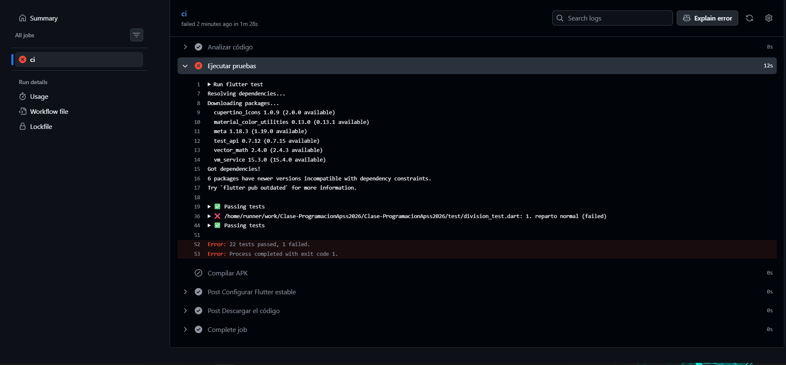
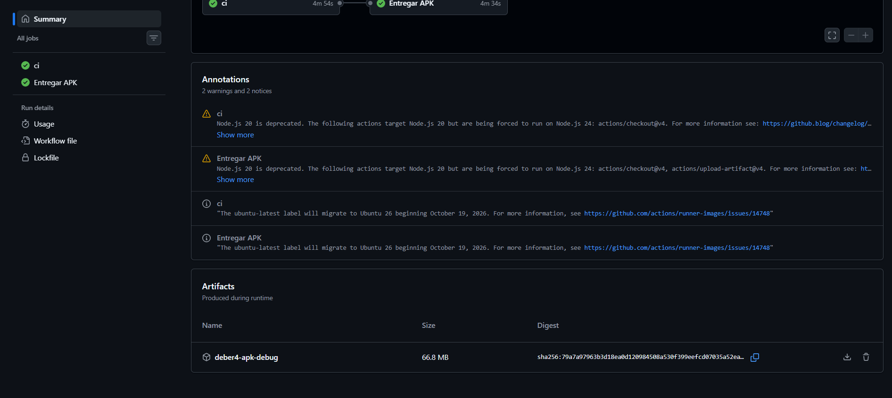
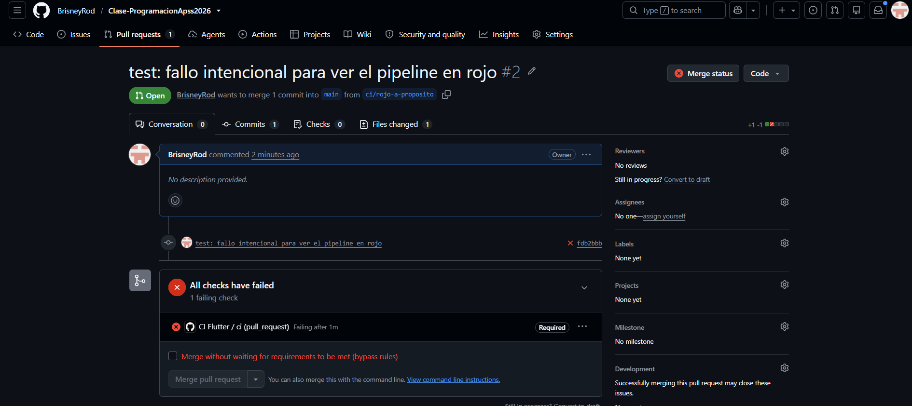
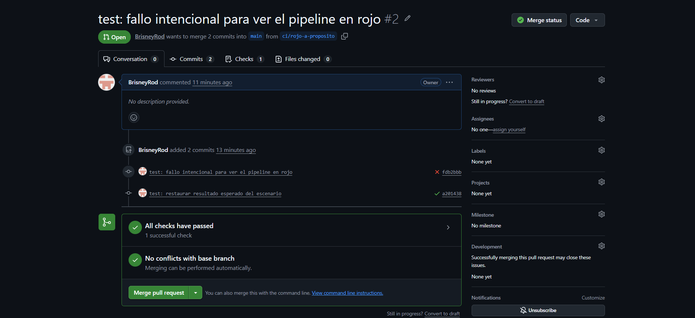

# Deber 4 — Respuestas

Proyecto: divisor de cuenta Flutter. La entrega se revisa desde este pull request; el workflow está en [`.github/workflows/ci.yml`](.github/workflows/ci.yml) y las capturas en [`evidencias/`](evidencias/).

## 1. Workflow y comandos

Este es el contenido de `ci.yml`:

```yaml
name: CI Flutter

on:
  push:
    branches:
      - main
  pull_request:

jobs:
  ci:
    runs-on: ubuntu-latest

    steps:
      - name: Descargar el código
        uses: actions/checkout@v4

      - name: Configurar Flutter estable
        uses: subosito/flutter-action@v2
        with:
          channel: stable

      - name: Instalar dependencias
        run: flutter pub get

      - name: Analizar código
        run: flutter analyze

      - name: Ejecutar pruebas
        run: flutter test

      - name: Compilar APK
        run: flutter build apk --debug

  entrega:
    name: Entregar APK
    needs: ci
    if: github.event_name == 'push' && github.ref == 'refs/heads/main'
    runs-on: ubuntu-latest

    steps:
      - name: Descargar el código
        uses: actions/checkout@v4

      - name: Configurar Flutter estable
        uses: subosito/flutter-action@v2
        with:
          channel: stable

      - name: Instalar dependencias
        run: flutter pub get

      - name: Generar APK
        run: flutter build apk --debug

      - name: Publicar APK como artifact
        uses: actions/upload-artifact@v4
        with:
          name: deber4-apk-debug
          path: build/app/outputs/flutter-apk/app-debug.apk
          if-no-files-found: error
```

- `analyze` revisa errores y advertencias estáticas del código.
- `test` ejecuta las pruebas automatizadas y falla si alguna no pasa.
- `build` compila el APK de depuración y comprueba que la app se puede construir.

## 2. Fallo del pipeline



La línea del log `test/division_test.dart: 1. reparto normal (failed)` identificó el escenario que falló; el resumen `22 tests passed, 1 failed` confirmó el resultado. Había cambiado a propósito el valor esperado de `27.50` a `27.00` en `test/casos_de_prueba.dart`.

## 3. Integración, entrega y despliegue continuos

Integración continua (CI) verifica automáticamente cada cambio. Entrega continua (CD) deja un producto generado y disponible tras pasar CI, pero una persona decide si lo publica. Despliegue continuo también lo publica automáticamente a los usuarios. Implementé CI y una entrega automatizada del APK como artifact; no hay despliegue a producción.



## 4. Merge bloqueado



El check `ci` es obligatorio en `main`: mientras falle, GitHub deshabilita el merge normal. Así se evita incorporar una prueba rota antes de corregirla. La corrección pasó en el mismo PR: .

## 5. Revisión crítica del agente

El agente señaló que Flutter `stable` y las etiquetas `@v2`/`@v4` pueden cambiar, que faltan permisos mínimos explícitos, que `subosito/flutter-action` es de terceros y que compilar dos veces cuesta tiempo. Acepté verificar el origen de las acciones antes de confiar en ellas: comprobé los repositorios de `actions/checkout`, `actions/upload-artifact` y `subosito/flutter-action`. Rechacé agregar más acciones o paquetes sin verificarlos; mantuve la doble compilación porque los jobs no comparten archivos. No modifiqué el workflow en esta revisión.

## 6. Qué significa un CI verde

Garantiza que este código pasó el análisis, las pruebas existentes y la compilación en ese entorno. No garantiza que todas las reglas de negocio sean correctas. Por ejemplo, un error al calcular una propina de `12.5 %` podría pasar en verde si ningún test cubre ese valor.

## 7. Qué detectó el pipeline

Al principio, el análisis en GitHub falló aunque localmente pasaba; al excluir del análisis los dos proyectos antiguos del repositorio, quedó verde. Luego el pipeline detectó que el escenario de reparto normal esperaba `27.00` cuando la app calculaba `27.50`, y bloqueó el merge hasta corregirlo.

## Evidencias restantes

- [Parte 1: primer CI verde](evidencias/parte1_ci_verde.png)
- [Parte 2: protección de `main`](evidencias/parte2_proteccion.png)
